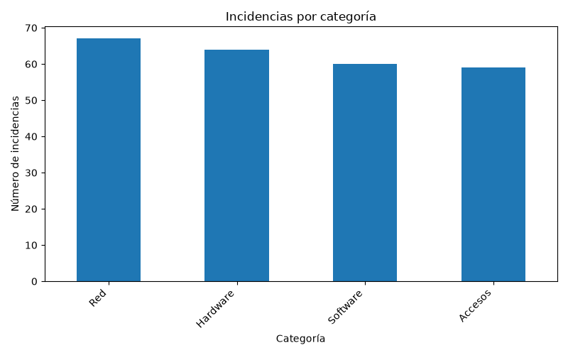
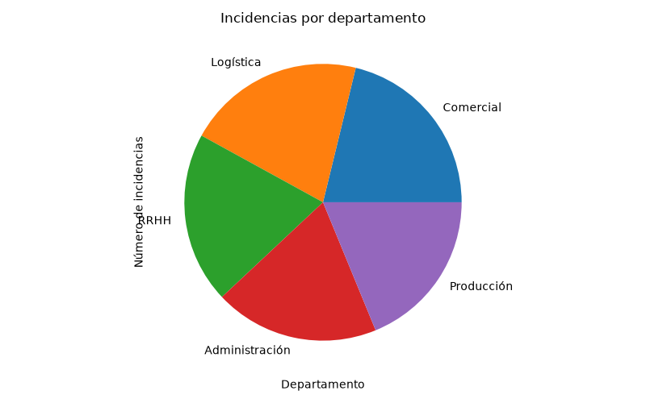
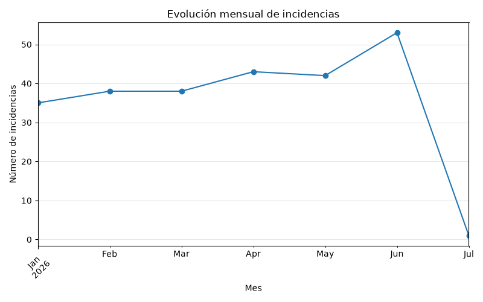

# Informe de incidencias IT

Se han analizado 250 incidencias para conocer las
necesidades de soporte y el estado de su resolución.

## Tres hallazgos principales

1. Red es la categoría con más incidencias, con
   67 casos (26.80 % del total).
   Conviene revisar sus problemas recurrentes para identificar
   posibles medidas de prevención.

2. Comercial registra el mayor volumen de incidencias,
   con 53 casos. Este dato ayuda a planificar
   el soporte, aunque no permite comparar tasas de incidencias
   sin conocer el tamaño de cada departamento.

3. El 69.60 % de las incidencias están cerradas,
   con una media de resolución de 3.63 horas.
   Quedan 76 incidencias abiertas o en curso que requieren
   seguimiento según su urgencia.

## Análisis adicional

### Resolución por prioridad

Media de horas de resolución de las incidencias cerradas:
- Alta: 3.70 horas.
- Baja: 3.59 horas.
- Crítica: 3.48 horas.
- Media: 3.64 horas.

### Mes con más incidencias

El mes 2026-06 registró el mayor volumen, con
53 incidencias. La categoría que más contribuyó
a ese volumen fue Hardware, con
17 casos.

### Cruce de categorías y departamentos

La hoja «Categoria x departamento» de salida/indicadores.xlsx
permite consultar cuántas incidencias de cada categoría
se registraron en cada departamento.

## Criterio de cálculo

Las medias de resolución se calculan únicamente sobre incidencias
cerradas, ignorando las horas vacías y sin sustituirlas por cero.
Si hay empate en un máximo, se muestra el primero obtenido.

## Gráficos

